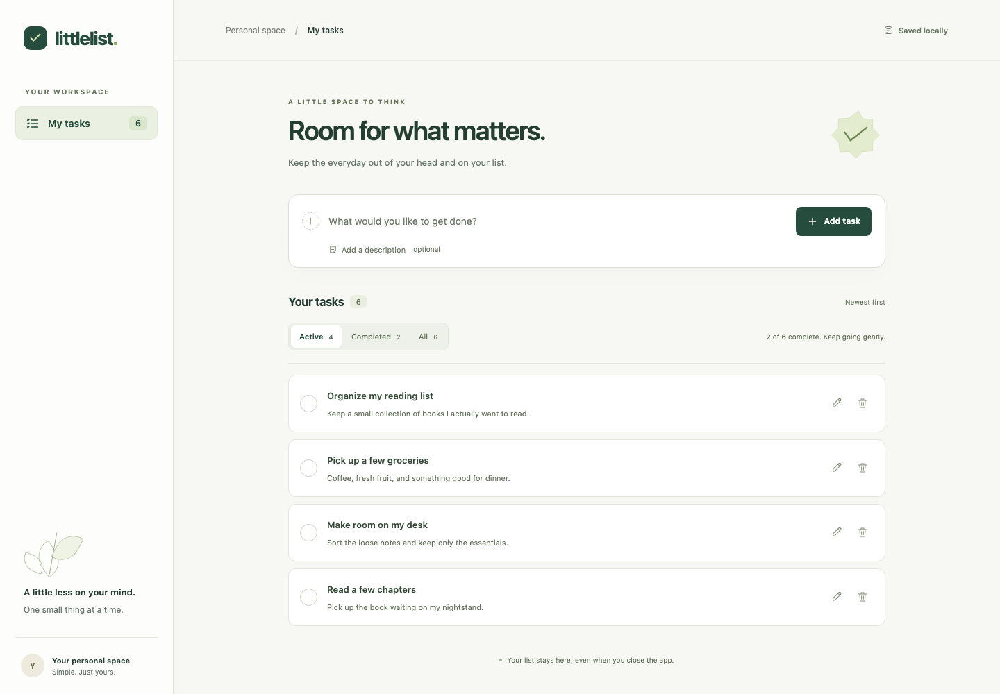

# Littlelist

A calm, responsive personal task list. This standalone CRUD application is the **BEFORE** baseline for a future existing-project SDLC adoption demonstration. No SDLC Orchestrator is installed or invoked by this application.



## Run locally

Use Node **25.9.0** (`nvm install && nvm use` if using nvm). Supported Node range: 24–25; SQLite is provided by Node. There are no runtime npm dependencies or build step.

```bash
npm ci
npm start
```

Open **http://127.0.0.1:3000**. The server listens only on the local loopback interface. Stop with Ctrl+C. If the port is occupied, use `PORT=3001 npm start`. `PORT=0` chooses a free port and prints its URL.

Tasks persist in **`~/.local/share/littlelist/tasks.sqlite`**, outside the source tree and installed dependencies. Restarting the server or browser preserves tasks. To use a separate database:

```bash
TODO_DB_PATH=/absolute/path/to/demo.sqlite PORT=3001 npm start
```

Relative database overrides resolve from the application root. `.env.example` documents options; environment files are not loaded automatically. No network services, accounts or internet connection are needed during normal operation after setup. This is a local web application, not a native mobile package.

## Task behavior

- Create a task with a required short title and optional description.
- View Active, Completed or All tasks, newest-created first.
- Complete or reopen a task in one action.
- Edit title and description; valid edits save automatically after a short pause.
- Empty titles show validation and retain the last saved value. **Cancel draft discards only unsaved/invalid edits; already autosaved changes remain saved.**
- Delete active or completed tasks after confirmation.

There are **no due dates, reminders, date fields, priorities, tags, multiple lists, accounts, synchronization or analytics**. See [behavior and architecture](docs/baseline.md) for implementation choices and limits.

## Execute tests

Install the pinned Playwright browser once:

```bash
npx playwright install chromium
npm run check
npm run test:unit
npm run test:integration
npm run test:browser
# Or all automated tests:
npm test
```

On Linux, Playwright may require its system dependencies (`npx playwright install --with-deps chromium`). Browser tests use the bundled Chromium, at desktop and mobile viewport sizes. They use real browsers and HTTP servers with isolated temporary databases, never your personal task database. `PLAYWRIGHT_CHANNEL=chrome npm run test:browser` optionally uses an installed Chrome; it is not the pinned baseline browser.

Disposable browser reports and failure traces live under `node_modules/.cache/littlelist/browser/`. Open a report with `npx playwright show-report node_modules/.cache/littlelist/browser/report`. No Firefox, WebKit or physical-device verification is claimed.

## BEFORE evidence and reproduction

[Demo runbook](demo/README.md) explains the frozen screenshots, recordings, source hashes and actual test logs. The annotated local tag **`baseline-crud`** identifies the initial application revision; `git show baseline-crud` inspects it. No push is performed by any script.
